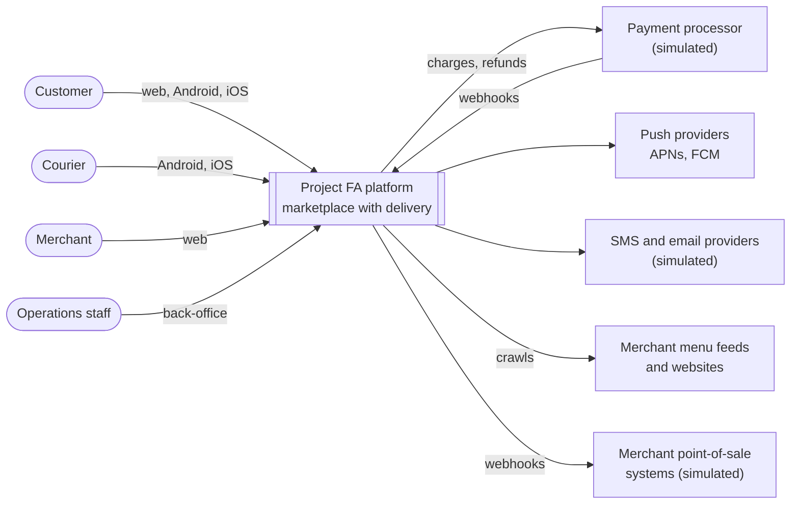

# Architecture overview

The diagrams follow the [C4 model](https://c4model.com/): first the system in its surroundings, then the containers inside it. Components are named as they are in the [catalog](../../catalog/components.yaml), which is the source of truth. If a diagram and the catalog disagree, the catalog wins and the diagram gets fixed.

## Context

Who and what the system talks to.

Every external dependency that could cost money or reach a real person is simulated. The fake payment processor can add latency, fail, and send duplicate or out-of-order webhooks on demand, because those are the behaviours worth testing against.

## Containers

The first business line, grouped by slice. Dashed boxes are proposed additions under review.

```mermaid
flowchart TB
  subgraph clients[Clients]
    web[Web app]
    android[Android app]
    ios[iOS app]
  end

  subgraph edge[Edge]
    gw[Envoy Gateway]
    rl[Global rate limiter]
    webbff[Web BFF]
    mobbff[Mobile BFF]
    idp[Keycloak]
    authz[OpenFGA]
  end

  subgraph browse[Browse and search]
    catalog[Catalog API]
    indexer[Search indexer]
    typeahead[Typeahead]
    crawler[Catalog crawler]
    backoffice[Back-office]
  end

  subgraph checkout[Cart and checkout]
    cart[Group cart]
    saga[Order and checkout saga]
    pricing[Pricing and promotions]:::proposed
    inventory[Inventory and flash sale]
    ledger[Payments and ledger]
    payouts[Payouts scheduler]
    fakepay[Fake payment processor]
  end

  subgraph delivery[Dispatch and tracking]
    dispatch[Dispatch matching]
    ingest[Location ingest]
    live[Live updates gateway]
    geo[Geo]:::proposed
    couriersvc[Courier service]:::proposed
  end

  subgraph engage[Engagement]
    notify[Notifications]
    feed[Deals feed]
    ads[Ad-click aggregation]
    links[Share links]
    photos[Photo pipeline]
  end

  subgraph data[Data stores and brokers]
    pg[(PostgreSQL)]
    crdb[(CockroachDB)]
    cass[(Cassandra)]
    mongo[(MongoDB)]
    valkey[(Valkey)]
    os[(OpenSearch)]
    ch[(ClickHouse)]
    s3[(SeaweedFS)]
    kafka{{Kafka}}
    nats{{NATS JetStream}}
    rabbit{{RabbitMQ}}
  end

  web --> gw
  android --> gw
  ios --> gw
  gw --> rl
  gw --> webbff
  gw --> mobbff
  gw --> live
  gw --> links
  webbff --> catalog & cart & saga
  mobbff --> catalog & saga & ingest

  saga --> pricing & inventory & ledger
  ledger --> fakepay
  saga --> kafka
  inventory --> valkey
  saga --> pg
  ledger --> pg
  ledger -. live migration .-> crdb
  payouts --> ledger

  catalog --> mongo
  mongo -. change streams .-> indexer
  indexer --> os
  typeahead --> os
  crawler --> catalog
  backoffice --> pg

  ingest --> kafka
  kafka --> cass
  ingest --> valkey
  dispatch --> valkey
  dispatch --> geo & couriersvc
  kafka --> nats
  nats --> live

  kafka --> notify
  notify --> rabbit
  kafka --> ads
  ads --> ch
  feed --> valkey
  photos --> s3

  classDef proposed stroke-dasharray: 5 5
```

The diagram leaves out identity and authorization calls (every service checks OpenFGA), the outbox relays, and the observability pipeline, which every service feeds.

## Three paths through the system

**Placing an order.** The client calls its backend-for-frontend, which calls the order saga. The saga prices the cart, reserves inventory, asks the ledger to authorise payment through the fake processor, and records each step in Postgres in the same transaction as an outbox row. A relay publishes the outbox to Kafka. Dispatch, notifications and analytics consume those events; none of them is called synchronously. Every write carries an idempotency key, stored with its effect in the owning service's database.

**A courier moving.** The courier app sends a position every 5 seconds to location ingest, which writes it to Kafka and keeps the latest position per courier in Valkey for dispatch. A consumer writes the history to Cassandra. Another bridges position events onto NATS, and the live updates gateway pushes them over WebSockets to the customers tracking that order.

**A menu changing.** The crawler or the back-office writes to the catalog API, which stores merchant catalogs as documents in MongoDB. The search indexer follows MongoDB's change streams and updates OpenSearch. The gap between a catalog write and a search hit is the freshness lag that the Phase 7 experiments measure.

## The test harness

The harness sits beside the system under test and never shares its CPUs.

| Part | Role |
|---|---|
| `sim` | Plays any component that isn't real yet, from a topology file |
| k6 | Open-model load from traffic models: Zipf item popularity, a diurnal curve, a flash crowd, a celebrity merchant, a courier location stream, a reconnect storm. Splits across devices with execution segments |
| Chaos Mesh, Toxiproxy | Faults at the Kubernetes level and inside integration tests |
| Invariant checkers | Read the recorded history and assert the business invariants during and after each run |
| OpenTelemetry, Prometheus, Tempo, Loki, Grafana | The measurement plumbing, kept boring on purpose |
| flagd | Toggles the fault endpoints every service exposes |

## Profiles

A laptop can't run everything at once, so the local cluster comes in three profiles. Phase 1 measures each one's memory and disk footprint. Owned machines and the clouds are other targets for the same system, described in [environments](environments.md).

| Profile | Runs |
|---|---|
| minimal | The simulated topology, Postgres, the observability stack |
| standard | Adds Kafka, Valkey and whichever slices are real |
| full | Everything, plus Chaos Mesh |
